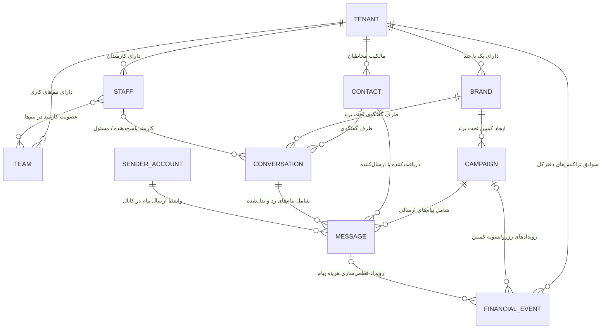

# مدل مفهومی داده و جداسازی چندسازمانی (نسخه اول)

این سند نتیجه نهایی `TASK-0002` است، پس از اجرای `antigraviti-elyas` (شاخه
`task/TASK-0002-data-model`، کامیت نهایی `10835d6`) و بازبینی مستقل
`chatgpt` (رأی `APPROVED`). بر اساس `docs/ai/product/TENANCY_AND_ACCESS.md`،
`docs/ai/product/SENDER_ACCOUNTS_AND_ROUTING.md` و
`docs/ai/governance/ABSOLUTE_PROHIBITIONS.md` تدوین شده است. این سند صرفاً
یک مدل مفهومی (Conceptual Data Model) است؛ هیچ DDL، Schema فیزیکی یا کد
Migration در این سند یا در این مرحله ساخته نمی‌شود.

> **یادداشت مدیر هنگام ادغام:** بازبین مستقل یک خطر باقی‌مانده یادآوری
> کرد: جزئیات فنی «ارجاع قطعی و قابل‌ردیابی» در بخش ۵.۲ (مثل الگوریتم
> دقیق تطبیق In-Reply-To) هنوز طراحی/آزمایش نشده و این سند فقط اصل
> معماری (نه پیاده‌سازی) را تثبیت می‌کند.

---

## ۱. موجودیت‌های اصلی مفهومی و مالکیت داده (Data Ownership)

در معماری سامانه، هر موجودیت اصلی دارای یک **ماژول مالک (Owning Module)** مشخص در هسته سامانه (NestJS Core) است. ماژول‌های دیگر حق دسترسی مستقیم یا ایجاد تغییرات در داده‌های متعلق به ماژول دیگر را بدون عبور از قراردادهای رسمی ماژول ندارند.

| ردیف | نام موجودیت | عنوان انگلیسی | ماژول مالک داده | نقش و مفهوم داده‌ای در سامانه |
| :--- | :--- | :--- | :--- | :--- |
| ۱ | **سازمان / مستأجر** | Tenant / Organization | ماژول هویت و سازمان‌ها (`Identity & Tenancy`) | بالاترین سطح مرزبندی منطقی داده؛ هر مشتری سازمانی یک مستأجر مجزا است و تمامی منابع زیرمجموعه آن تعریف می‌شوند. |
| ۲ | **برند** | Brand | ماژول سازمان و برند (`Tenancy & Brand Management`) | هویت تجاری و خط کسب‌وکار یک سازمان؛ یک سازمان می‌تواند چند برند داشته باشد تا ارسال پیام‌ها و پاسخ‌ها تفکیک شوند. |
| ۳ | **تیم و کارمند** | Team & Staff / Member | ماژول اعضا و دسترسی (`Access & Member Management`) | کاربران پنل مشتری (مدیر سازمان، کارشناس فروش، پشتیبان)؛ تعیین دسترسی‌ها، عضویت در تیم‌ها و انتساب گفتگوهای ورودی. |
| ۴ | **مخاطب** | Contact | ماژول مخاطبان (`Contact Management`) | اشخاص حقیقی یا حقوقی دریافت‌کننده پیام در کانال‌های ارتباطی؛ ثبت شماره، شناسه کانال و وضعیت رضایت دریافت پیام. |
| ۵ | **کمپین** | Campaign | ماژول کمپین‌ها (`Campaign Management`) | واحد عملیات ارسال گروهی پیام؛ دربرگیرنده تنظیمات ارسال، کانال هدف، بازه زمانی، تخصیص بودجه و پیام‌های متناظر. |
| ۶ | **پیام** | Message | ماژول پیام‌رسانی و صف (`Messaging & Delivery`) | ریزترین واحد تبادل داده (متن، رسانه یا دکمه) در کانال‌های ارتباطی؛ دارای شناسه رهگیری یکتا، وضعیت ارسال و وضعیت مالی. |
| ۷ | **حساب فرستنده** | Sender Account | ماژول فرستنده‌ها و مسیریابی (`Sender Management & Routing`) | حساب‌های عملیاتی ارسال پیام (شامل حساب متصل خود مشتری و حساب مدیریت‌شده تأمین‌شده توسط شرکت) و پایش وضعیت سلامت آن‌ها. |
| ۸ | **گفتگوی صندوق ورودی** | Inbox Conversation / Thread | ماژول صندوق ورودی یکپارچه (`Unified Inbox`) | تاریخچه مکالمه دوطرفه میان یک مخاطب و یک برند/سازمان روی یک کانال مشخص، همراه با کارمند منتسب‌شده و وضعیت مکالمه. |
| ۹ | **رویداد مالی / دفترکل** | Financial / Ledger Event | ماژول حسابداری و مالی (`Billing & Ledger`) | سابقه غیرقابل تغییر (Append-only) هرگونه رخداد مالی اعم از شارژ، رزرو اعتبار، کسر قطعی هزینه پیام و تعدیل تراکنش‌ها. |

---

## ۲. روابط مفهومی میان موجودیت‌ها

**تشریح روابط کلیدی:**
1. هر کارمند متعلق به یک سازمان است و می‌تواند هم‌زمان در چند تیم حضور داشته باشد؛ حذف کارمند دسترسی او را مسدود می‌کند اما سوابق انتساب گذشته باقی می‌ماند و گفتگوهای فعال او به حالت «بدون مسئول» تغییر می‌یابد.
2. مخاطبان در سطح سازمان نگهداری می‌شوند؛ ارتباط با برند مشخص یا اشتراک صریح میان برندهای همان سازمان از طریق متادیتا و سیاست‌های سازمانی کنترل می‌شود.
3. هر کمپین زیرمجموعه یک برند و سازمان اجرا می‌شود؛ پیام‌های کمپین از طریق یک حساب فرستنده واجد شرایط به سمت Connectorها ارسال می‌شوند.
4. هر گفتگوی Inbox میان یک مخاطب خاص و یک برند/سازمان روی یک کانال مشخص شکل می‌گیرد؛ در نسخه اول، انتقال گفتگو میان کارمندان درون سازمان مجاز است.
5. هر تغییر موجودی سازمان یک رکورد در دفترکل (Ledger) است که ممکن است به یک کمپین (رزرو/آزادسازی) یا یک پیام خاص (کسر هزینه قطعی) مرتبط باشد.

---

## ۳. قواعد جداسازی داده و مرزبندی سازمانی (Multi-Tenancy Isolation)

### ۳.۱. اصل بنیادین شناسه سازمان (`tenant_id`)
تمامی موجودیت‌های تجاری مستقر در پایگاه داده باید به‌صورت صریح و اجباری دارای شناسه سازمان (`tenant_id`) باشند. کوئری‌ها، صف‌های پردازش پیام و کش‌های حافظه موقت (Redis) موظفند همواره کلید سازمان را در فیلترها و کلیدهای خود لحاظ کنند تا امکان دسترسی متقاطع از ریشه منتفی شود.

### ۳.۲. قواعد اختصاصی برای موجودیت‌های حساس

**الف) مخاطبان (Contacts)**
- جداسازی مطلق سازمان‌ها: فهرست مخاطبان، شماره‌ها، برچسب‌ها و وضعیت‌های رضایت هرگز میان دو سازمان مجزا به اشتراک گذاشته نمی‌شوند.
- تفکیک میان برندها: رضایت ثبت‌شده یک مخاطب برای یک برند، مجوز ارسال از طریق برند دیگر (حتی در همان سازمان) تلقی نمی‌شود، مگر رضایت صریح و مستقل برای آن برند ثبت شده باشد.
- **مخاطبان انصراف‌داده (Opt-out):** مخاطبی که انصراف خود را ثبت کرده یا در لیست مسدودی قرار گرفته، در سطح سازمان/برند علامت‌گذاری شده و ارسال پیام به او متوقف می‌ماند مگر اینکه مخاطب دوباره رضایت صریح جدیدی ثبت کند (توقف ارسال تا زمان لغو/تغییر رضایت پایدار است و قطع دائمی و بدون استثنا نیست).

**ب) پیام‌ها و محتوای گفتگوها (Messages & Conversations)**
- متن پیام‌ها، رسانه‌ها و سوابق گفتگوهای یک سازمان تحت هیچ شرایطی نباید در سازمان دیگر قابل مشاهده، جستجو یا بازیابی باشد.
- متن گفتگوها یا داده‌های مشتریان هرگز نباید به‌عنوان داده آموزشی یا ورودی مشترک برای مدل‌های هوش مصنوعی سایر سازمان‌ها استفاده شود.
- دسترسی سوپرادمین برای نظارت، به‌صورت ممیزی‌شده (Audited) است و هر مشاهده با شناسه کاربر ناظر، زمان و علت در تاریخچه امنیتی ذخیره می‌شود.

**ج) رویدادهای مالی و دفترکل (Financial / Ledger Events)**
- دفترکل مالی کاملاً بر مبنای `tenant_id` ایزوله است؛ تجمیع یا پوشش هزینه‌های یک سازمان با اعتبارات سازمان دیگر ممنوع است.
- مدل غیرقابل ویرایش (Append-only): هیچ رکوردی قابل حذف، ویرایش مستقیم یا بازنویسی نیست؛ اصلاح صرفاً از طریق تراکنش معکوس (Compensating Transaction) است.
- هرگونه اقدام سوپرادمین برای افزودن اعتبار دستی یا اعمال سقف منفی باید دارای دلیل رسمی، شناسه کاربر اقدام‌کننده و ردپای شفاف باشد.

---

## ۴. اشتراک منابع مشترک و حساب‌های مدیریت‌شده (Shared Resources)

### ۴.۱. طبقه‌بندی حساب‌های فرستنده
1. **حساب متصل مشتری (Customer-Connected Account):** ۱۰۰٪ اختصاصی همان سازمان (`tenant_id` مستقیماً به آن سازمان اشاره دارد).
2. **حساب مدیریت‌شده (Managed Account):** تهیه‌شده توسط خدمتگزاران تک یا تأمین‌کننده زیرساخت؛ ممکن است ظرفیت ارسال آن میان چند سازمان مشتری تقسیم شود.

### ۴.۲. سازوکار پیشگیری از نشت داده در حساب‌های مدیریت‌شده
1. **شناسه رهگیری یکتا در پیام‌های خروجی:** هر پیام ارسالی از حساب مدیریت‌شده با یک شناسه رهگیری یکتا تولید و ثبت می‌شود و هویت برند سفارش‌دهنده در ابتدای متن پیام درج می‌شود.
2. **تفکیک پاسخ‌ها بر مبنای ارجاع مستقیم (In-Reply-To):** Connector شناسه پیام مرجع را استخراج و به هسته سیستم گزارش می‌کند؛ هسته با تطبیق پیام مرجع، سازمان، برند و گفتگوی اختصاصی را در Inbox بازمی‌یابد.
3. **ارجاع قطعی و ممنوعیت حدس‌زنی:** پاسخ فقط وقتی به‌صورت خودکار به یک گفتگو/کمپین متصل می‌شود که یک ارجاع قابل‌ردیابی و قطعی وجود داشته باشد. اتصال خودکار بر اساس «آخرین کمپین ارسالی»، حدس متن، کلمات کلیدی یا گمانه‌زنی اکیداً ممنوع است.
4. **صف بازبینی انسانی:** در صورت نبود ارجاع قطعی یا هرگونه ابهام، پاسخ باید به «صف بازبینی انسانی» برود و هرگز به‌صورت خودکار در پنل هیچ سازمانی نمایش داده نشود.
5. **حفاظت کامل از نشست‌ها:** فایل‌های نشست، کوکی‌ها و توکن‌های ورود حساب‌های مدیریت‌شده هرگز به پنل مشتری ارسال نمی‌شوند.

---

## ۵. موارد باز (ارجاع به OPEN_PRODUCT_QUESTIONS.md)

این سند هیچ عدد یا تصمیم تجاری باز را قطعی فرض نکرده است:

1. مدت زمان نگهداری داده‌ها — **باز، نیازمند تصمیم مالک.**
2. جزئیات حقوقی/مالی اشتراک منابع میان چند سازمان — **باز، نیازمند تصمیم مالک.**
3. تعریف دقیق رویداد قابل‌صورتحساب هر کانال — **باز، نیازمند پایلوت** (هم‌راستا با `TASK-0005`).
4. تعرفه‌ها، قیمت‌ها، بسته‌ها و سقف اعتبار منفی — **باز، نیازمند تصمیم مالک.**
5. ساعت دقیق بازه امن ارسال پیام (Quiet Hours) — **باز، نیازمند تصمیم مالک.**
6. نمایش یا عدم نمایش شناسه فرستنده مدیریت‌شده به مشتری — **باز، نیازمند تصمیم مالک.**
