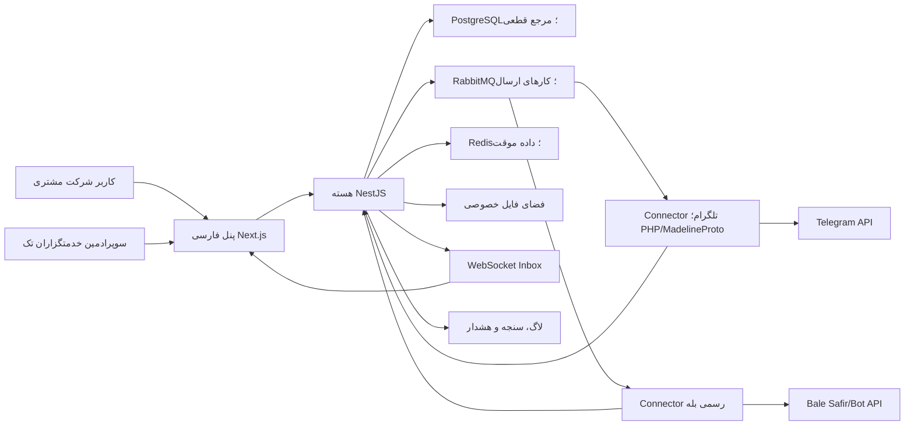

# زمینه و مرز کلان سیستم

## مرزهای غیرقابل عبور

- Connectorها فقط قرارداد پیام را اجرا می‌کنند و مالک منطق مالی یا مجوز نیستند.
- پنل مستقیماً به Connector یا دیتابیس متصل نمی‌شود.
- هر عملیات تجاری دارای `tenant_id` اجباری است.
- رویداد زنده جای ثبت قطعی در PostgreSQL را نمی‌گیرد.
- خرابی یک کانال نباید پنل یا کانال دیگر را متوقف کند.

