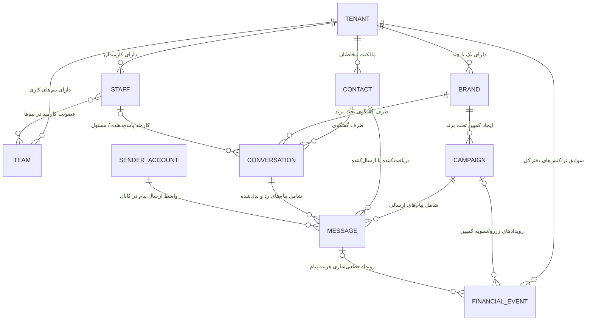

# پیش‌نویس مدل مفهومی داده و جداسازی چندسازمانی (DRAFT_DATA_MODEL)

- **شناسه مأموریت:** TASK-0002
- **وضعیت سند:** پیش‌نویس تحلیلی (Draft Conceptual Model)
- **مالک مأموریت:** ai_manager
- **تهیه‌کننده:** antigraviti-elyas
- **بازبین:** chatgpt

---

## ۱. مقدمه و دامنه سند

این سند در پاسخ به الزامات مأموریت `TASK-0002` و به عنوان گام تحلیلی مندرج در `docs/ai/governance/AUTONOMOUS_ANALYSIS_GOAL.md` تدوین شده است. هدف از این سند، تبیین مدل مفهومی موجودیت‌های کلیدی داده، مرزبندی ماژول‌های مالک داده، روابط میان آن‌ها و تعیین قواعد سخت‌گیرانه جداسازی چندسازمانی (Multi-Tenancy) و مدیریت منابع اشتراکی است.

> [!IMPORTANT]
> این سند صرفاً یک **مدل مفهومی (Conceptual Data Model)** است. هیچ‌گونه کد اسکریپت پایگاه داده (DDL)، تعریف جدول فیزیکی (Physical Schema)، یا کدهای نگاشت شیء-رابطه‌ای (ORM/Migration) در این سند و در این مرحله تولید نمی‌شود.

---

## ۲. موجودیت‌های اصلی مفهومی و مالکیت داده (Data Ownership)

در معماری سامانه، هر موجودیت اصلی دارای یک **ماژول مالک (Owning Module)** مشخص در هسته سامانه (NestJS Core) است. ماژول‌های دیگر حق دسترسی مستقیم یا ایجاد تغییرات در داده‌های متعلق به ماژول دیگر را بدون عبور از قراردادهای رسمی ماژول ندارند.

| ردیف | نام موجودیت | عنوان انگلیسی | ماژول مالک داده | نقش و مفهوم داده‌ای در سامانه |
| :--- | :--- | :--- | :--- | :--- |
| ۱ | **سازمان / مستأجر** | Tenant / Organization | ماژول هویت و سازمان‌ها (`Identity & Tenancy`) | بالاترین سطح مرزبندی منطقی داده؛ هر مشتری سازمانی یک مستأجر مجزا است و تمامی منابع زیرمجموعه آن تعریف می‌شوند. |
| ۲ | **برند** | Brand | ماژول سازمان و برند (`Tenancy & Brand Management`) | هویت تجاری و خط کسب‌وکار یک سازمان؛ یک سازمان می‌تواند چند برند داشته باشد تا ارسال پیام‌ها و پاسخ‌ها تفکیک شوند. |
| ۳ | **تیم و کارمند** | Team & Staff / Member | ماژول اعضا و دسترسی (`Access & Member Management`) | کاربران پنل مشتری (مدیر سازمان، کارشناس فروش، پشتیبان)؛ تعیین دسترسی‌ها، عضویت در تیم‌ها و انتساب گفتگوهای ورودی. |
| ۴ | **مخاطب** | Contact | ماژول مخاطبان (`Contact Management`) | اشخاص حقیقی یا حقوقی دریافت‌کننده پیام در کانال‌های ارتباطی؛ ثبت شماره، شناسه کانال و وضعیت رضایت دریافت پیام. |
| ۵ | **کمپین** | Campaign | ماژول کمپین‌ها (`Campaign Management`) | واحد عملیات ارسال گروهی پیام؛ دربرگیرنده تنظیمات ارسال، کانال هدف، بازه زمانی، تخصیص بودجه و پیام‌های متناظر. |
| ۶ | **پیام** | Message | ماژول پیام‌رسانی و صف (`Messaging & Delivery`) | ریزترین واحد تبادل داده (متن، رسانه یا دکمه) در کانال‌های ارتباطی؛ دارای شناسه رهگیری یکتا، وضعیت ارسال و وضعیت مالی. |
| ۷ | **حساب فرستنده** | Sender Account | ماژول فرستنده‌ها و مسیریابی (`Sender Management & Routing`) | حساب‌های عملیاتی ارسال پیام (شامل حساب متصل خود مشتری و حساب مدیریت‌شده تأمین‌شده توسط شرکت) و پایش وضعیت سلامت آن‌ها. |
| ۸ | **گفتگوی صندوق ورودی** | Inbox Conversation / Thread | ماژول صندوق ورودی یکپارچه (`Unified Inbox`) | تاریخچه مکالمه دوطرفه میان یک مخاطب و یک برند/سازمان روی یک کانال مشخص، همراه با کارمند منتسب‌شده و وضعیت مکالمه. |
| ۹ | **رویداد مالی / دفترکل** | Financial / Ledger Event | ماژول حسابداری و مالی (`Billing & Ledger`) | سابقه غیرقابل تغییر (Append-only) هرگونه رخداد مالی اعم از شارژ، رزرو اعتبار، کسر قطعی هزینه پیام و تعدیل تراکنش‌ها. |

---

## ۳. روابط مفهومی میان موجودیت‌ها

ارتباطات مفهومی میان این موجودیت‌ها بازتاب‌دهنده ساختار عملیاتی پلتفرم چندسازمانی است:

### تشریح روابط کلیدی:
1. **سازمان با برندها، تیم‌ها و کارمندان:** هر کارمند متعلق به یک سازمان است. کارمند می‌تواند هم‌زمان در چند تیم (مانند فروش و پشتیبانی) حضور داشته باشد. حذف کارمند دسترسی او را مسدود می‌کند، اما سوابق انتساب گذشته او باقی می‌ماند و گفتگوهای فعال او به حالت «بدون مسئول» تغییر می‌یابند.
2. **سازمان و برند با مخاطبان:** مخاطبان در سطح سازمان نگهداری می‌شوند تا از تکثیر نامنظم جلوگیری شود، اما ارتباط با برند مشخص یا اشتراک صریح میان برندهای همان سازمان از طریق متادیتا و سیاست‌های سازمانی کنترل می‌شود.
3. **کمپین، پیام و حساب فرستنده:** هر کمپین زیرمجموعه یک برند و سازمان اجرا می‌شود. پیام‌های درون کمپین از طریق یک حساب فرستنده واجد شرایط (حساب متصل مشتری یا حساب مدیریت‌شده) به سمت Connectorها ارسال می‌گردند.
4. **صندوق ورودی (Inbox):** هر گفتگو میان یک مخاطب خاص و یک برند/سازمان روی یک کانال مشخص شکل می‌گیرد. در نسخه اول، انتقال گفتگو میان کارمندان درون سازمان مجاز است و پیام‌های جدید دریافت شده به همان گفتگو متصل می‌شوند.
5. **ارتباط مالی:** هر تغییر موجودی سازمان به شکل یک رکورد در دفترکل (Ledger) ثبت می‌شود که ممکن است مستقیماً به یک کمپین (رزرو یا آزادسازی باقیمانده) یا یک پیام خاص (کسر هزینه قطعی) مرتبط باشد.

---

## ۴. قواعد جداسازی داده و مرزبندی سازمانی (Multi-Tenancy Isolation)

بر اساس سند `docs/ai/product/TENANCY_AND_ACCESS.md` و دستورالعمل‌های `docs/ai/governance/ABSOLUTE_PROHIBITIONS.md`، هیچ نقشی (حتی سوپرادمین) و هیچ مسیر فراخوانی (API) حق دور زدن مرزهای چندسازمانی را ندارد.

### ۴.۱. اصل بنیادین شناسه سازمان (`tenant_id`)
تمامی موجودیت‌های تجاری مستقر در پایگاه داده باید به صورت صریح و اجباری دارای شناسه سازمان (`tenant_id`) باشند. کوئری‌ها، صف‌های پردازش پیام و کش‌های حافظه موقت (Redis) موظفند همواره کلید سازمان را در فیلترها و کلیدهای خود لحاظ کنند تا امکان دسترسی متقاطع از ریشه منتفی شود.

### ۴.۲. قواعد اختصاصی برای موجودیت‌های حساس

#### الف) مخاطبان (Contacts)
- **جداسازی مطلق سازمان‌ها:** فهرست مخاطبان، اطلاعات شناسنامه‌ای، شماره‌ها، برچسب‌ها و وضعیت‌های رضایت (Opt-in / Opt-out) هرگز و تحت هیچ شرایطی میان دو سازمان مجزا به اشتراک گذاشته نمی‌شوند.
- **تفکیک میان برندها:** رضایت ثبت‌شده یک مخاطب برای یک برند، به هیچ‌وجه مجوز ارسال از طریق برند دیگر (حتی در همان سازمان) تلقی نمی‌شود، مگر اینکه ثبت رضایت صریح و مستقل برای آن برند وجود داشته باشد.
- **مخاطبان انصراف‌داده (Opt-out):** مخاطبی که انصراف خود را ثبت کرده یا در لیست مسدودی قرار گرفته، در سطح سازمان/برند علامت‌گذاری شده و ارسال پیام به او متوقف می‌ماند مگر اینکه مخاطب دوباره رضایت صریح جدیدی ثبت کند (توقف ارسال تا زمان لغو/تغییر رضایت پایدار است و قطع دائمی و بدون استثنا نیست).

#### ب) پیام‌ها و محتوای گفتگوها (Messages & Conversations)
- **عدم نشت داده:** متن پیام‌ها، رسانه‌ها، فایل‌های ارسالی/دریافتی و سوابق گفتگوهای یک سازمان تحت هیچ شرایطی نباید در سازمان دیگر قابل مشاهده، جستجو یا بازیابی باشد.
- **ایزولاسیون پردازش هوش مصنوعی:** متن گفتگوها یا داده‌های مشتریان هرگز نباید به عنوان داده آموزشی یا ورودی مشترک برای مدل‌های هوش مصنوعی مورد استفاده سایر سازمان‌ها قرار گیرد.
- **شفافیت دسترسی سوپرادمین:** دسترسی مدیران ارشد خدمتگزاران تک جهت نظارت بر حسن اجرای تعهدات و سلامت محتوا، به صورت ممیزی‌شده (Audited) خواهد بود و هرگونه مشاهده با شناسه کاربر ناظر، زمان و علت در تاریخچه امنیتی سیستم ذخیره می‌گردد.

#### ج) رویدادهای مالی و دفترکل (Financial / Ledger Events)
- **جداسازی کامل حسابداری:** دفترکل مالی به طور کامل بر مبنای `tenant_id` سازمان ایزوله است. تجمیع، تهاتر، یا پوشش هزینه‌های یک سازمان با اعتبارات سازمان دیگر ممنوع است.
- **مدل غیرقابل ویرایش (Append-only Ledger):** هیچ رکوردی در جدول رویدادهای مالی قابل حذف، ویرایش مستقیم یا بازنویسی نیست. هرگونه اصلاح یا خطایابی صرفاً از طریق ثبت یک تراکنش معکوس (Compensating Transaction) صورت می‌پذیرد.
- **تغییرات مدیریتی:** هرگونه اقدام سوپرادمین برای افزودن اعتبار دستی یا اعمال سقف منفی، الزماً باید دارای دلیل رسمی، شناسه کاربر اقدام‌کننده و ثبت ردپای شفاف در سوابق همان سازمان باشد.

---

## ۵. نحوه اشتراک منابع مشترک و حساب‌های مدیریت‌شده (Shared Resources)

یکی از چالش‌های بنیادین معماری، استفاده از **حساب‌های مدیریت‌شده (Managed Accounts)** توسط شرکت خدمتگزاران تک جهت ارائه خدمت به چندین مشتری بدون ایجاد نشت داده است (مطابق با `docs/ai/product/SENDER_ACCOUNTS_AND_ROUTING.md`).

### ۵.۱. طبقه‌بندی حساب‌های فرستنده
1. **حساب متصل مشتری (Customer-Connected Account):** حسابی است که توسط خود مشتری به پنل متصل شده و ۱۰۰٪ اختصاصی همان سازمان است (`tenant_id` مستقیماً به آن سازمان اشاره دارد).
2. **حساب مدیریت‌شده (Managed Account):** حسابی که توسط خدمتگزاران تک یا تأمین‌کننده زیرساخت تهیه شده، دارای پروفایل ثابت و عمومی/خنثی بوده و ممکن است ظرفیت ارسال آن در طول زمان میان چند سازمان مشتری تقسیم شود.

### ۵.۲. سازوکار پیشگیری از نشت داده در حساب‌های مدیریت‌شده
جهت جلوگیری از اختلاط پاسخ‌های دریافتی از مخاطبان سازمان‌های مختلف روی یک حساب مشترک:

1. **شناسه رهگیری یکتا در پیام‌های خروجی (`Tracking ID / Outbound Context`):**
   - هر پیام ارسالی از حساب مدیریت‌شده با یک شناسه رهگیری یکتا تولید و ثبت می‌شود.
   - هویت شرکت/برند سفارش‌دهنده به صورت شفاف و استاندارد در ابتدای متن پیام درج می‌شود تا مخاطب بداند با چه برندی طرف است.
2. **تفکیک پاسخ‌ها بر مبنای ارجاع مستقیم (In-Reply-To):**
   - هنگامی که مخاطب با استفاده از امکان Reply در پلتفرم (مثلاً تلگرام یا بله) به پیام ارسالی پاسخ می‌دهد، Connector شناسه پیام مرجع را استخراج کرده و به هسته سیستم گزارش می‌کند.
   - هسته سیستم با تطبیق پیام مرجع، سازمان (`tenant_id`)، برند (`brand_id`) و گفتگوی اختصاصی مربوط به همان مشتری را در صندوق ورودی باز می‌یابد.
3. **تفکیک پاسخ‌ها بر مبنای ارجاع قطعی و مدیریت موارد فاقد ارجاع:**
   - پاسخ فقط وقتی به‌صورت خودکار به یک گفتگو/کمپین متصل می‌شود که یک ارجاع قابل‌ردیابی و قطعی (مثل شناسه پیام اصلی یا شناسه مکالمه) وجود داشته باشد.
   - **حذف هرگونه حدس‌زنی:** اتصال خودکار بر اساس «آخرین کمپین ارسالی به مخاطب»، حدس متن، کلمات کلیدی یا گمانه‌زنی به دلیل نقض قاعده عدم‌حدس‌زنی در اسناد محصول و خطر نشت داده، اکیداً ممنوع و منتفی است.
   - **صف بازبینی انسانی (Human Review):** در صورت عدم وجود ارجاع قطعی و قابل‌ردیابی یا وجود هرگونه ابهام، پاسخ باید مستقیماً به «صف بازبینی انسانی مدیریت سامانه» برود و هرگز به‌صورت خودکار در پنل هیچ سازمانی نمایش داده نمی‌شود تا خطر نمایش گفتگوی یک مشتری به اپراتور یا مخاطب اشتباه به‌طور کامل از بین برود.
4. **حفاظت کامل از نشست‌ها (Sessions & Secrets):**
   - فایل‌های نشست (Session)، کوکی‌ها و توکن‌های ورود حساب‌های مدیریت‌شده هرگز به پنل مشتری ارسال نمی‌شوند و توسط مشتری قابل دریافت، ویرایش یا مشاهده نیستند.

---

## ۶. تصمیم‌های باز محصول (Open Product Questions)

مطابق الزامات سند `docs/ai/product/OPEN_PRODUCT_QUESTIONS.md`، هیچ تصمیم تجاری باز یا عدد فرضی نباید در این مدل قطعی قلمداد شود. این موارد مشخصاً به صورت **«باز»** ثبت می‌شوند:

1. **مدت زمان نگهداری داده‌ها (Data Retention Policy):**
   - *وضعیت:* **باز (نیازمند تصمیم بعدی مالک محصول)**
   - *شرح:* مدت زمان دقیق نگهداری متن پیام‌ها، فایل‌ها و رسانه‌های ارسالی/دریافتی در Storage و زمان آرشیو یا پاکسازی لاگ‌های سیستمی هنوز تعیین نشده و پس از تصویب سیاست‌های حقوقی و زیرساختی اعمال خواهد شد.
2. **جزئیات و قراردادهای اشتراک منابع میان چند سازمان:**
   - *وضعیت:* **باز (نیازمند تصمیم بعدی مالک محصول)**
   - *شرح:* شرایط دقیق حقوقی و مالی برای اشتراک منابع زیرساختی یا قراردادهای کلان میان دو یا چند سازمان مشتری همچنان باز است.
3. **تعریف دقیق رویداد قابل‌صورتحساب در هر کانال (Billable Event Definition):**
   - *وضعیت:* **باز (نیازمند تحقیق و فاز پایلوت)**
   - *شرح:* این موضوع که آیا تحویل پیام به سرور پیام‌رسان، دریافت پیام در دستگاه مخاطب، یا مشاهده پیام توسط مخاطب ملاک کسر نهایی اعتبار است، برای هر کانال (تلگرام، بله، پیامک و ...) پس از اجرای آزمایشی (Pilot) تعیین و در اسناد تعرفه درج می‌شود.
4. **تعرفه‌ها، قیمت‌ها، بسته‌ها و سقف اعتبار منفی:**
   - *وضعیت:* **باز (نیازمند تصمیم بعدی مالک محصول)**
   - *شرح:* مبالغ ریالی هر پیام، بسته‌های اشتراک، هزینه تمایز حساب متصل مشتری در برابر حساب مدیریت‌شده و سقف اعتبار مجاز منفی، باید در سیستم به عنوان متغیرهای پیکربندی باقی بمانند و هیچ عدد ثابتی در مدل داده تثبیت نمی‌شود.
5. **ساعت دقیق بازه امن ارسال پیام (Quiet Hours):**
   - *وضعیت:* **باز (نیازمند تصمیم بعدی مالک محصول)**
   - *شرح:* ساعات شبانه‌روزی مجاز برای اجرای خودکار کمپین‌ها و پیشگیری از اعتراض یا گزارش اسپم از سوی کاربران.
6. **شرایط نمایش یا عدم نمایش شناسه فرستنده مدیریت‌شده به مشتری:**
   - *وضعیت:* **باز (نیازمند تصمیم بعدی مالک محصول)**
   - *شرح:* اینکه آیا شماره، شناسه عمومی یا آیدی حساب مدیریت‌شده در پنل به مشتری نشان داده شود یا صرفاً به عنوان یک «فرستنده عمومی» گزارش شود، پس از نهایی شدن نیازمندی‌های محصول تثبیت می‌گردد.

---

## ۷. انطباق با نبایدهای مطلق و بازگشت‌پذیری (Governance & Compliance)

- **انطباق با ABSOLUTE_PROHIBITIONS.md:**
  - هیچ داده‌ای بین دو سازمان اشتراک داده نمی‌شود.
  - هیچ موجودی مالی به صورت مستقیم ویرایش نمی‌شود (فقط تراکنش‌های افزایشی در دفترکل).
  - هیچ فرضیه حدسی برای موارد باز تعریف نشده است.
  - کدهای واقعی یا تغییر در فایلهای مسدود (`blocked_paths`) انجام نگرفته است.
- **طرح بازگشت (Rollback Plan):**
  - از آنجا که این کار صرفاً ایجاد یک فایل مستند تحلیلی جدید در مسیر `docs/ai/tasks/TASK-0002/DRAFT_DATA_MODEL.md` روی شاخه `task/TASK-0002-data-model` است، بازگشت به سادگی با حذف این شاخه یا فایل امکان‌پذیر است و هیچ تغییری روی شاخه `main` یا بخش‌های عملیاتی مخزن اعمال نمی‌شود.
